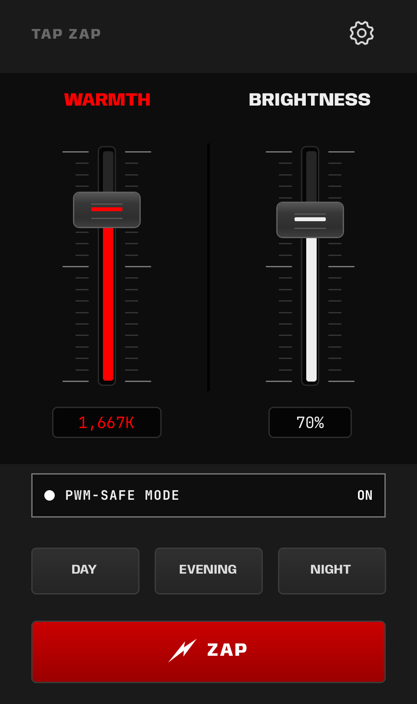
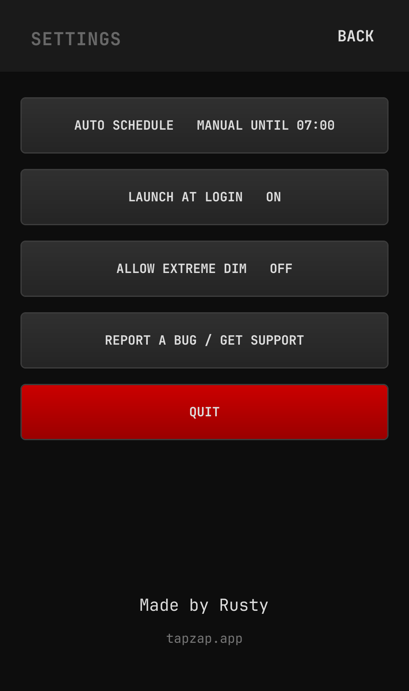
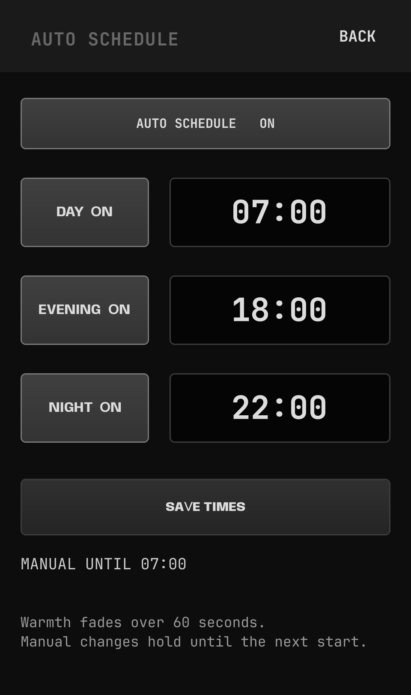
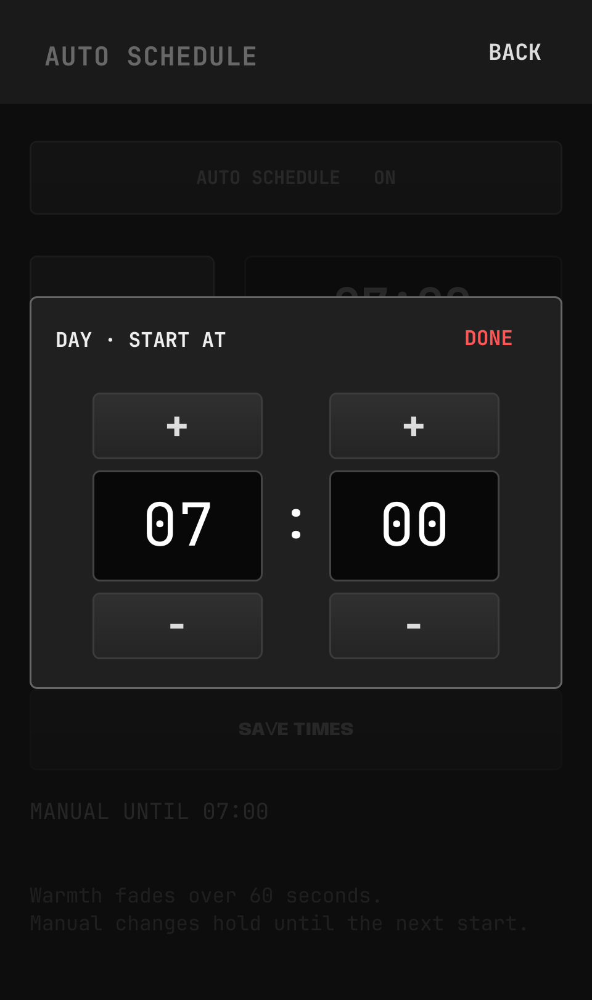
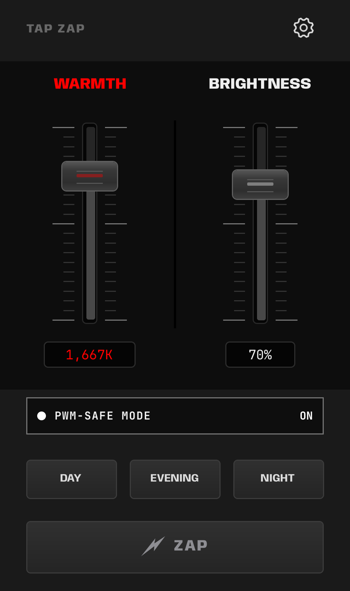

# Screenshots

TAP ZAP 0.3.0 on Omarchy. [Install guide](OMARCHY.md).

## Main panel

Adjust warmth and brightness, or choose DAY, EVENING or NIGHT.

## Settings

Schedules, launch at login, Extreme Dim and support.

## Auto Schedule

Choose your presets and start times. Manual changes hold until the next start.

## Time picker

Set the hour and minute. Choose Done, then Save Times.

## Filter off

ZAP switches the filter on or off. Your settings are saved.

## Bar icon

Open TAP ZAP from the lightning icon. Its color follows your Omarchy theme.

Native QML renders at 3× resolution with example settings, made October 12, 2026
using Omarchy 4.0.2 and Quickshell 0.3.1. See [Validation](VALIDATION.md) for display test results.
